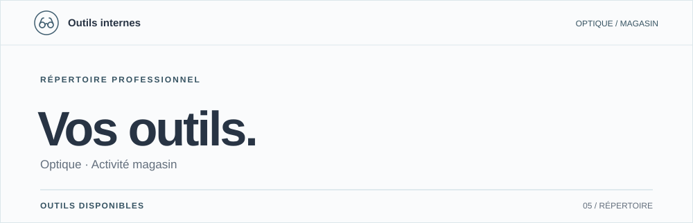

<div align="center">
  
</div>

<p align="center">
  <a href="https://j-rbs91.github.io/Hub_Tools_N_Templates/"><strong>Accéder au hub</strong></a>
  &nbsp;·&nbsp;
  <a href="#01--outils-disponibles">Les outils</a>
  &nbsp;·&nbsp;
  <a href="#03--données-et-confidentialité">Confidentialité</a>
  &nbsp;·&nbsp;
  <a href="#05--développement-et-déploiement">Documentation technique</a>
</p>

Un répertoire d'outils pour le travail quotidien en magasin d'optique : courriers, clôture de caisse, calculs optiques et fonctions en cours de mise au point.

**Un site statique, sans compte à créer ni serveur applicatif à administrer.** Chaque magasin peut renseigner ses coordonnées depuis **Mon magasin**. Les outils récupèrent ensuite les informations utiles sur le même navigateur.

---

## 01 / Outils disponibles

| N° | Outil | Fonction | Accès |
| :-- | :-- | :-- | :-- |
| **01** | **[Demande / Ordonnance](outils/demande-ordonnance/)** | Courriers destinés aux médecins, export PDF et copie pour Gmail. | Ouvert |
| **02** | **[Clôture de caisse](outils/cloture-caisse/)** | Comptage, comparaison avec le logiciel métier, fond de caisse et historique local. | Ouvert |
| **03** | **[Épaisseur des verres](outils/epaisseur-verres/)** | Calcul OD/OG, choix de formes et visualisation 3D. | Ouvert |
| **04** | **[Lentilles souples](outils/lentilles-souples/)** | Conversion lunettes/lentilles, surréfraction et recherche catalogue. | Par code, en mise au point |
| **05** | **Campagne e-mail** | Préparation et suivi de communications clients. | Bientôt |

Les trois premiers outils sont directement accessibles depuis l'accueil. **Lentilles souples** affiche un écran d'accès par code : l'outil est encore en cours de mise au point. **Campagne e-mail** reste volontairement fermé depuis le hub, le temps d'encadrer son utilisation et les exigences applicables aux communications commerciales.

Les calculs optiques sont des **aides à la décision professionnelle**. Ils ne remplacent ni les vérifications de l'opticien ni une prescription.

## 02 / Mon magasin

Le bouton **Mon magasin**, en haut de l'accueil, sert à renseigner le nom, l'adresse, le téléphone et l'e-mail du magasin, ainsi que le fond de caisse. Ces réglages sont enregistrés sur le poste et réutilisés par les outils concernés.

Deux solutions facultatives permettent de conserver ou retrouver le paramétrage :

| Méthode | Fonctionnement | Limite |
| :-- | :-- | :-- |
| **[Synchronisation Google Drive](docs/sync-drive/)** | Le magasin déploie son propre Google Apps Script pour partager son profil entre plusieurs postes. | Seul le profil magasin est synchronisé, jamais les données de patients. |
| **[Sauvegarde par fichier](docs/sauvegarde-fichier/)** | Export et restauration d'un fichier JSON contenant les réglages et l'historique de caisse prévu par l'outil. | Transfert manuel, sans synchronisation automatique. |

Sans synchronisation, le profil reste **propre à chaque navigateur**. Deux ordinateurs ne partagent pas leurs réglages simplement parce qu'ils ouvrent la même adresse.

## 03 / Données et confidentialité

Le fonctionnement repose principalement sur le navigateur : pas de backend applicatif du projet, pas de base de données centrale, pas de cookie publicitaire ni de CDN pour les outils. Les saisies métier, notamment les données de patients, ne sont pas envoyées à un serveur du projet.

Les échanges externes existants sont explicitement délimités :

- **Fréquentation :** l'accueil et les pages des outils utilisent [GoatCounter](https://www.goatcounter.com/), sans cookie, pour mesurer les visites. Le compteur ne reçoit pas le contenu des formulaires métier.
- **Contact :** le formulaire « Contact » de l'accueil transmet le nom, l'adresse e-mail, le message et les informations de contexte prévues par le formulaire via **EmailJS**, afin de remettre le message par e-mail.
- **Synchronisation facultative :** si elle est configurée, **Google Apps Script / Google Drive** transporte uniquement les paramètres du magasin vers l'espace Google contrôlé par le magasin.
- **Campagnes e-mail :** les fonctions d'envoi assisté ou automatique sont distinctes du stockage local des contacts et restent soumises aux conditions d'utilisation décrites dans la documentation dédiée.

Les exports PDF et les contenus copiés pour Gmail sont préparés dans le navigateur. Le traitement ultérieur d'un document exporté ou d'un message envoyé relève de l'outil choisi par l'utilisateur.

Pour le détail des traitements et les règles applicables : **[CGU et confidentialité](cgu/)** · **[RGPD et campagnes e-mail](docs/rgpd-mailing/)** · **[Documentation des campagnes](docs/campagne-email/)**.

## 04 / Architecture

```text
index.html                 Accueil et configuration du magasin
assets/css/                Styles et identité visuelle commune
outils/                    Outils métier
  demande-ordonnance/
  cloture-caisse/
  epaisseur-verres/
  lentilles-souples/
  campagne-email/
docs/                      Guides et procédures
cgu/                       Conditions d'utilisation et confidentialité
tests/                     Contrôles de comportement et de navigation
.github/workflows/         CI, sécurité et déploiement
```

**Socle :** HTML, CSS et JavaScript, sans framework, compilation ni gestionnaire de dépendances pour exécuter le site. Le stockage local utilise `localStorage`, notamment la clé commune `profil-magasin-v1`. Les pages des outils conservent leur autonomie ; certains outils disposent désormais de feuilles de style dédiées.

La direction artistique en vigueur est **Répertoire professionnel**, documentée dans [l'identité UXER](.uxer/identity.md). Le rendu repose sur le fond `#FAFBFC`, l'encre `#283444`, l'accent bleu-gris `#405E70`, une hiérarchie typographique nette et des séparateurs fins. Les feuilles de style effectives du hub sont [hub.css](assets/css/hub.css), [repertoire.css](assets/css/repertoire.css), puis [theme-bleu-gris.css](assets/css/theme-bleu-gris.css).

## 05 / Développement et déploiement

### Exécuter localement

Aucune installation applicative n'est nécessaire. Pour servir les pages avec une origine locale cohérente :

```sh
git clone https://github.com/J-Rbs91/Hub_Tools_N_Templates.git
cd Hub_Tools_N_Templates
python3 -m http.server 8000
```

Ouvrir ensuite **http://localhost:8000/** dans le navigateur.

### Publier

Le site est publié par **GitHub Pages** depuis la branche `main`, via [le workflow de déploiement](.github/workflows/deploy.yml). À la première installation, sélectionner **Settings → Pages → Build and deployment → GitHub Actions**. Les changements de documentation interne ou de README ne nécessitent pas, à eux seuls, un nouveau déploiement du site.

### Contrôler les modifications

```sh
# Validation HTML, selon la version utilisée par le projet
npx --yes html-validate@11.5.6 "**/*.html"

# Tests de navigation, lorsqu'ils sont modifiés ou concernés
node --test tests/*.test.mjs
```

La CI prévoit également des contrôles de liens et de fichiers, de l'analyse statique et de la détection de secrets. Pour contribuer, consulter [CONTRIBUTING.md](CONTRIBUTING.md), [CLAUDE.md](CLAUDE.md) et [SECURITY.md](SECURITY.md).

---

<sub>Outils internes · Magasins d'optique · <a href="cgu/">Conditions d'utilisation</a></sub>
